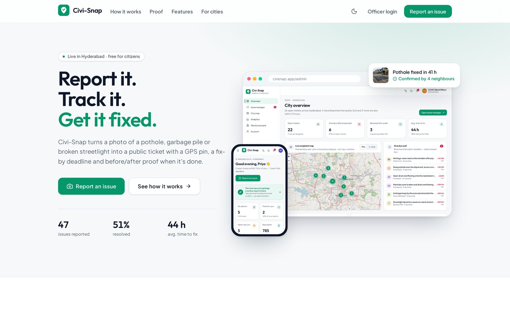
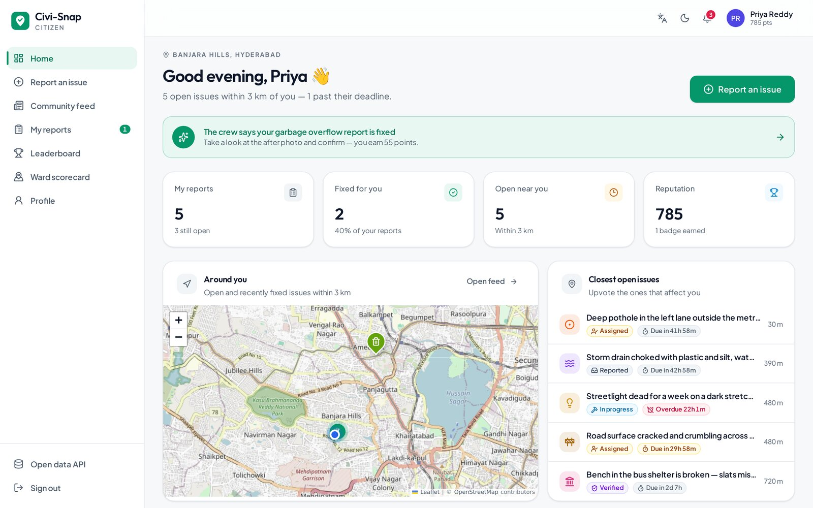
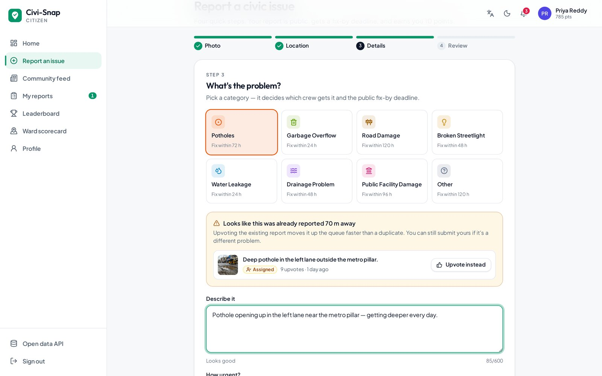
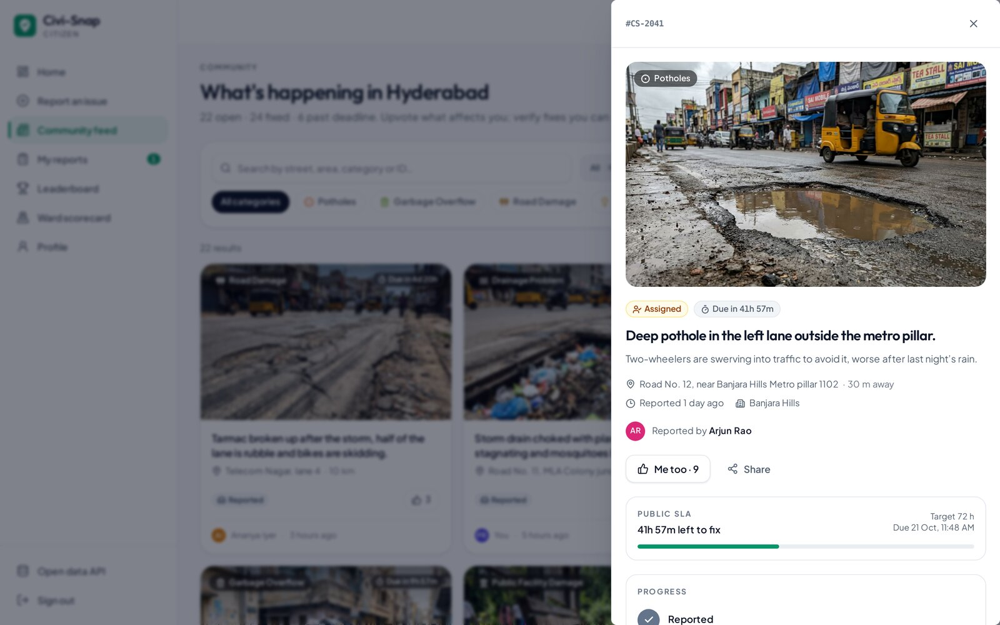
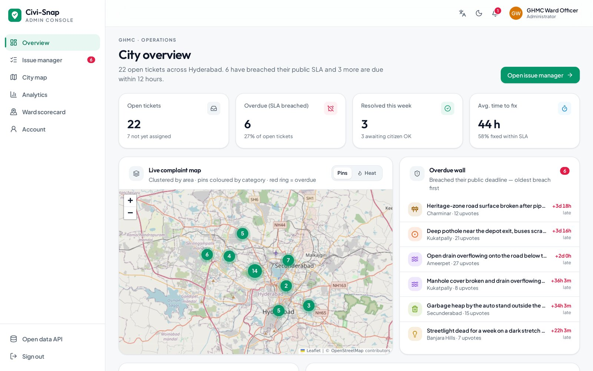
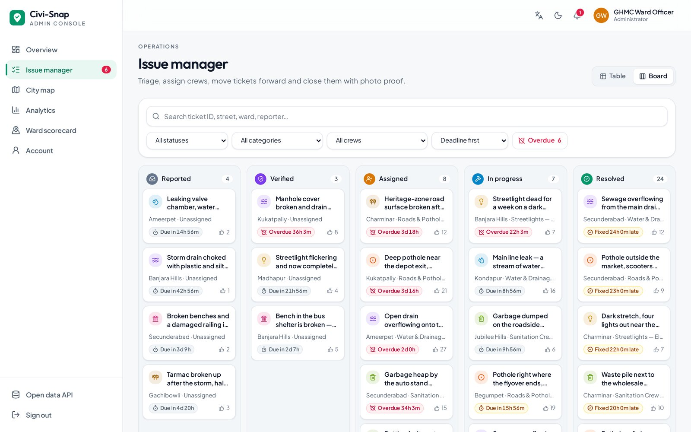
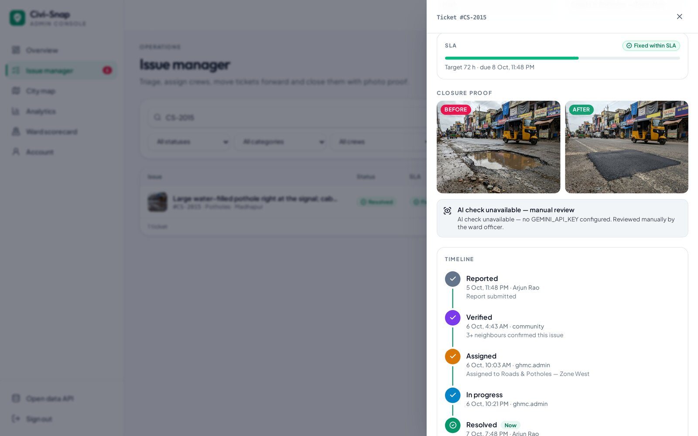
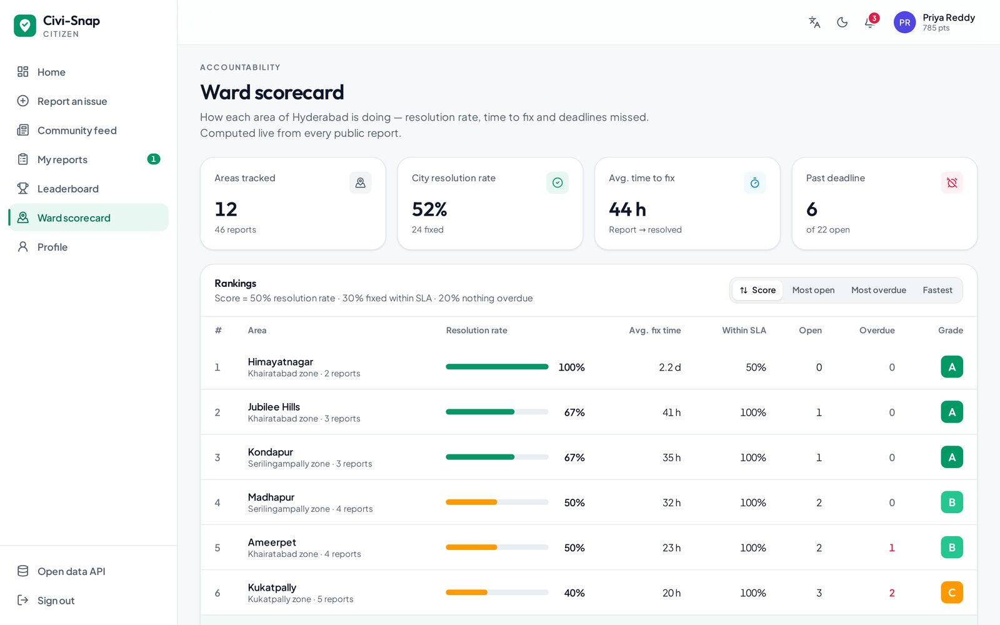
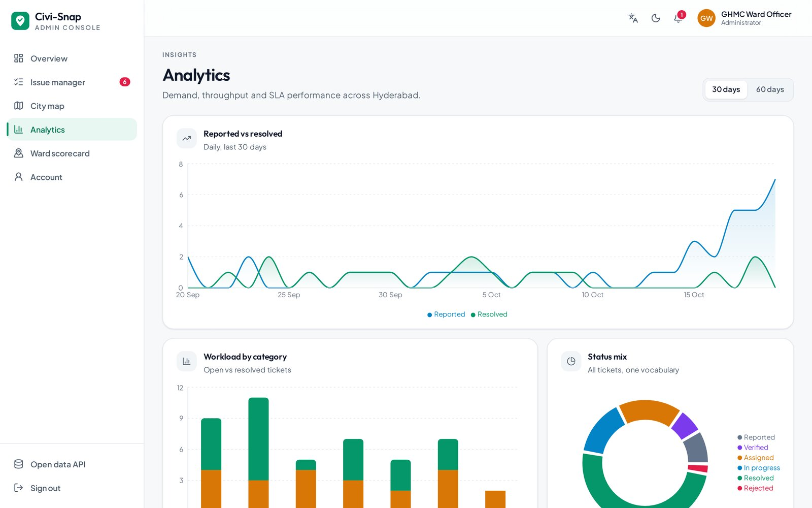
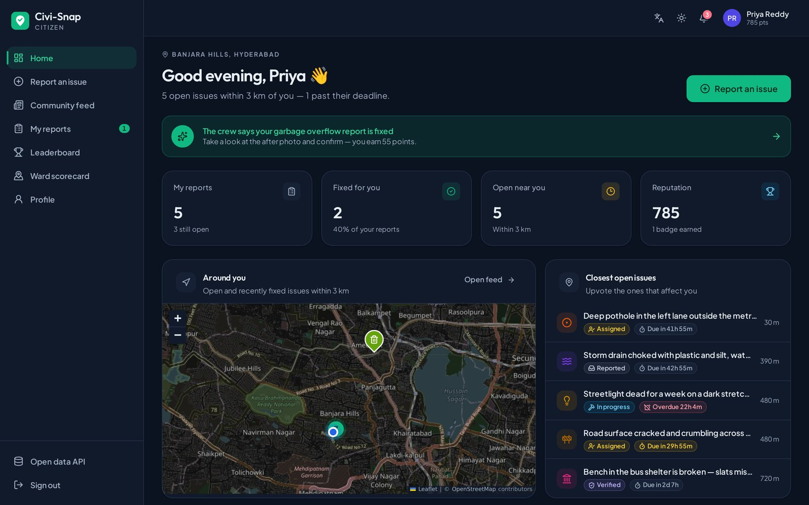

# Civi-Snap — report it, track it, get it fixed

Civi-Snap turns a photo of a pothole, garbage pile or broken streetlight into a **public ticket** with a GPS pin, a fix-by deadline and before/after proof when it's done. Citizens report and verify; ward officers triage, assign and close with evidence.



## Features

**For citizens**
- **4-step report flow:** photo (GPS read from EXIF) → map pin → category & details → review.
- **Duplicate detection:** open issues of the same category within 100 m are shown, with *Upvote instead*. Three upvotes mark an issue Verified.
- **Public SLA countdown** on every issue, plus an Overdue filter.
- **Status timeline:** Reported → Verified → Assigned → In progress → Resolved (or Rejected).
- **Confirm the fix:** compare before/after photos and confirm or reopen.
- Community feed (list + clustered map), My reports, leaderboard podium, reputation & badges.

**For ward officers (admin console)**
- City overview: KPIs, **overdue wall**, live complaint map (category pins, clustering, heatmap).
- Issue manager as a table or kanban board; assign crews, change status.
- **Before/after closure proof.** With `GEMINI_API_KEY` set, Gemini compares the photos and gives a verdict. Without it the issue shows *AI check unavailable — manual review*, never a fake score.
- **Ward scorecards:** resolution rate, average time to fix, share fixed within SLA, and an A–E grade.
- Analytics with trends, categories and status mix.

**Everywhere:** dark mode (follows the system, with a toggle), mobile bottom nav, skeleton/empty/error states, AA contrast, reduced-motion support.

| Citizen dashboard | Duplicate check | Issue + SLA |
|---|---|---|
|  |  |  |
| **Admin overview** | **Kanban** | **Closure proof** |
|  |  |  |
| **Ward scorecard** | **Analytics** | **Dark mode** |
|  |  |  |

## Stack
React 19 · Vite 6 · Tailwind v4 · motion · react-leaflet (OpenStreetMap) · Recharts · Express · MongoDB/Mongoose · Google Gemini (optional).

## Run locally
```bash
npm install
cp .env.example .env          # all values optional for local dev
# start MongoDB on 127.0.0.1:27017
npm run seed:demo             # 47 realistic issues across 12 Hyderabad areas
npm run dev                   # http://localhost:3000
```

**Demo logins**
- Citizen: `priya@demo.civisnap.in`. Sign-in uses an email code; without email configured, the code is shown on screen in dev only.
- Ward officer: `ghmc.admin` / `CiviSnap@2026`

Screens are deep-linkable, e.g. `/user#feed&issue=CS-2041`.

## Scripts
`npm run dev` · `npm run build` · `npm run typecheck` · `npm run seed:demo` · `npm start`

SLA hours per category live in `shared/civic.ts` (`SLA_HOURS`); emergencies get half.

## Credits
Original project by Lohitha Bandirala and team. The original project report is in [docs/PROJECT_REPORT.md](docs/PROJECT_REPORT.md).
